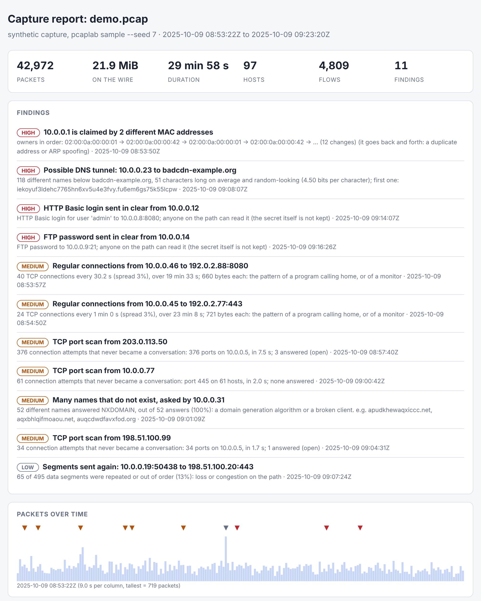

# pcaplab: read packet captures and find what looks wrong

[](https://github.com/TexAlphaWolf/net-packet-capture-lab/actions/workflows/ci.yml)
[](https://github.com/TexAlphaWolf/net-packet-capture-lab/actions/workflows/codeql.yml)


A command-line tool that reads a `pcap` or `pcapng` file and tells you what is in it and what looks wrong: port scans,
DNS tunnels, domain-generation storms, beacons, ARP conflicts, passwords sent in clear, and lossy connections. It
needs **no dependencies** (Python standard library only), reads captures as a stream, and hides what it should not
keep (passwords are never stored, and `--anonymize` makes the output safe to publish).



## Why

Wireshark shows every packet; what you often need first is the short list of things worth a second look. pcaplab
decodes the packets itself, builds the conversations (flows) and runs seven detectors with thresholds you can read
and change. Every claim in this README is measured, and the tests check the numbers below against
[`docs/report.json`](docs/report.json).

## Quick start

```bash
pip install git+https://github.com/TexAlphaWolf/net-packet-capture-lab.git
pcaplab sample -o demo.pcap --seed 7          # a synthetic capture with known attacks
pcaplab summary demo.pcap                     # what is inside, and the findings
pcaplab report demo.pcap -o report.html       # one self-contained HTML page (no script)
```

With Docker (no network needed, read-only root, no capabilities):

```bash
docker build -t pcaplab .
docker run --rm --network none -v "$PWD":/data pcaplab summary capture.pcap
```

## What it finds

| Finding | Rule (defaults, all adjustable) |
|---|---|
| Port scan | 15 or more distinct host:port probes within 60 s; shape vertical, horizontal or block |
| DNS tunnel | 25 or more unique names below one domain, long (mean 18+) and random-looking (entropy 3.3+ bits) |
| NXDOMAIN storm | 20 or more distinct names that do not exist, and 30% or more of that client's answers |
| Beacon | 8 or more regular connections (median gap 5 s or more, jitter 15% or less) to one place |
| ARP conflict | one IP claimed by two or more MAC addresses; high severity if it goes back and forth |
| Clear-text credentials | HTTP Basic and FTP `PASS` (the secret itself is not kept) |
| Retransmissions | 10 or more repeated segments and 5% or more of a flow |

Known benign sources are handled with `--allow HOST` (monitors, scanners) and `--ignore-domain DOMAIN` (CDNs, security
products). The limits are in [docs/limitations.md](docs/limitations.md).

## Commands

| Command | What it does |
|---|---|
| `summary` | the capture at a glance, with the findings |
| `findings` | only the findings; exit code 1 if there are any (use it in scripts); `--json` |
| `flows` | the conversations, biggest first (`--sort`, `--state`, `--top`) |
| `dns` | names asked and TLS server names (SNI) seen |
| `report -o FILE` | HTML, Markdown, JSON or text, by extension |
| `filter FILE EXPR -o OUT` | copy the matching packets to a new pcap |
| `sample -o FILE` | a synthetic capture with known truth (`--seed`, `--duration`, `--truth`) |

`-` reads from standard input (`ssh host tcpdump -U -w - | pcaplab summary -`). Exit code 2 means an error.
Every command takes `-f EXPRESSION`, `--min-severity`, and `--anonymize`.

Filter language: `tcp udp icmp icmp6 arp ip ip6 eth dns http tls vlan [N]`, `host/src/dst ADDR`, `net CIDR`,
`port N`, `portrange A-B`, `name TEXT`, `syn synack rst fin`, `error`, with `and`, `or`, `not` and parentheses.
Example: `pcaplab flows capture.pcap -f 'tcp and not port 443' --state refused`.

## Sample output

`pcaplab findings demo.pcap` (seed 7, trimmed):

```
[high] 10.0.0.1 is claimed by 2 different MAC addresses
    owners in order: 02:00:0a:00:00:01 -> 02:00:0a:00:00:42 -> ... (12 changes); it goes back and forth: a duplicate address or ARP spoofing
[high] Possible DNS tunnel: 10.0.0.23 to badcdn-example.org
    118 different names below badcdn-example.org, 51 characters long on average and random-looking (4.50 bits per character)
[high] HTTP Basic login sent in clear from 10.0.0.12
    HTTP Basic login for user 'admin' to 10.0.0.8:8080; anyone on the path can read it (the secret itself is not kept)
[medium] TCP port scan from 203.0.113.50
    376 connection attempts that never became a conversation: 376 ports on 10.0.0.5, in 7.5 s; 3 answered (open)
```

## Measured results

Full run on Linux x86_64, Python 3.13, seeds 1000 and up. Details and method: [docs/evaluation.md](docs/evaluation.md).

- **Decoder against scapy**: 20,000 random packets, **157,549** fields compared, **0** different. On 11 real
  Wireshark test-suite captures: 694 packets, 2,796 fields, 0 different.
- **Detectors against known truth**: 40 captures of 30 minutes (1,714,358 packets) with **440** injected things:
  **440 of 440** found, **0** false findings, **0** duplicates. 15 quiet captures (605,704 packets) gave **0** false
  findings.
- **Against naive rules** (the first idea: "many ports", "regular timing"): port-scan 635 alerts (515 false), beacon
  600 (520 false), NXDOMAIN 80 (40 false), DNS tunnel 80 (40 false).
- **Thresholds are a trade-off, and the data shows where**: a monitor that checks 12 ports every 5 minutes is a false
  scan at a threshold of 5 or 10 targets (60 false findings), clean at 15; a beacon minimum of 3 gives 155 false
  findings, 5 gives 113, 8 gives 0.
- **What it misses, by design**: a scan slower than one probe every four seconds (40 injected, 0 found), beacons with
  50% jitter.
- **Speed**: 499,728 packets (266 MiB) in about 4 s end to end, **125,917 packets/s**, peak memory **52.9 MiB**
  (about 1.4 KiB per flow); read alone 1,036,010 packets/s.

## Design

Stream reader (pcap and pcapng, microsecond and nanosecond) → decoder (never raises) → one-pass analyzer → detectors
→ reports. Ethernet with VLAN, Linux cooked v1/v2, BSD loopback and raw IP link types; IPv4, IPv6 with extension
headers, TCP, UDP, ICMP, ARP, DNS, HTTP first lines and TLS SNI. See [docs/architecture.md](docs/architecture.md).

## Security

The HTML report has no script and a strict Content-Security-Policy. Passwords are never kept. `--anonymize` replaces
addresses and names with stable random-keyed labels. Captured data is treated as hostile: the decoder has bounded
loops and limits. See [SECURITY.md](SECURITY.md).

## Development

```bash
pip install -e ".[dev]"
ruff check . && ruff format --check . && mypy && pytest -n auto --cov
python tools/evaluate.py --quick --check    # the evaluation (add --real DIR for real captures)
```

CI runs the tests on Python 3.11 to 3.14 on Linux, Windows and macOS, the evaluation, CodeQL, and a Docker end-to-end
test on Linux and Windows. See [CONTRIBUTING.md](CONTRIBUTING.md) and the [changelog](CHANGELOG.md).

## License

MIT, Luca Tessitore.
