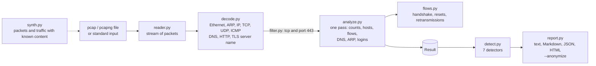

# Architecture

One pass over the file, as a stream: `reader.py` yields `Packet` records, `decode.py` turns each into a `Decoded`
(never raising: a packet it cannot read comes back with `error` set), the optional filter drops packets, and
`analyze.py` folds what is left into one `Result`. The detectors read only the `Result`, so they can be tested with
small hand-made captures and scored against the generator (`synth.py`).

| Module | Does |
|---|---|
| `reader.py` | pcap (both byte orders, µs and ns), pcapng (several sections, interface time resolution); damaged files are refused, files cut off in the last record are read up to there |
| `decode.py` | link layers (Ethernet with VLAN, Linux cooked v1 and v2, BSD loopback, raw IP), ARP, IPv4, IPv6 with extension headers, TCP, UDP, ICMP; DNS (compression pointers, loops refused), HTTP/1.x first line and headers, TLS ClientHello server name |
| `flows.py` | flows keyed by the two endpoints; TCP handshake state, resets, repeated segments with 32-bit sequence wrap, round-trip time from SYN to SYN-ACK; a new SYN on a closed flow starts a new one |
| `analyze.py` | the single pass: protocol counts, hosts, packets per second, DNS per client and domain, NXDOMAIN per client, ARP owners per address, clear-text logins; every table that the network can grow is capped |
| `detect.py` | port scans, DNS tunnels, NXDOMAIN storms, beacons, ARP conflicts, clear-text credentials, TCP retransmissions; thresholds in one dataclass |
| `filtering.py` | a small filter language (`tcp and port 443`, `host 10.0.0.5 and not dns`, `name example.com`) |
| `report.py` | the four formats and the anonymiser |
| `synth.py` | packet builders, pcap/pcapng writers and a traffic generator that injects known attacks |

## How the detectors decide

| Finding | Rule | Why it is built this way |
|---|---|---|
| port scan | a source sends ≥ 15 TCP connection attempts to different host:port pairs within 60 s that never become a conversation: no answer, a refusal, no final ACK, or a handshake closed at once without a byte of data | counting connections is not enough: a client opens many; the missing conversation is the signature |
| DNS tunnel | one client asks ≥ 25 different names below one domain, on average ≥ 18 characters long and ≥ 3.3 bits per character | tunnels carry data in the name; plain count, length or entropy alone each have common benign cases |
| NXDOMAIN storm | ≥ 20 different names that do not exist for one client, ≥ 30% of its answers | domain generation algorithms; a few typos are not enough |
| beacon | ≥ 8 connections from one host to one destination and port, median gap ≥ 5 s, the gaps' median absolute deviation ≤ 15% of the median, and ≥ 80% of the gaps within 30% of it | robust to one missed beat; NTP, DNS, DHCP, mDNS, SSDP and NetBIOS ports are ignored by default |
| ARP conflict | one IPv4 address announced by more than one MAC address; high if the owner comes back (two machines fight) | an address probe (sender 0.0.0.0) does not count as a claim |
| clear-text credentials | an HTTP `Authorization: Basic` header or an FTP `PASS` | the secret is dropped when the packet is parsed, so no output can hold it |
| TCP retransmissions | a flow with ≥ 10 repeated or out-of-order segments, ≥ 5% of its data segments | |

## Choices

- **Standard library only.** The decoders are small and fully tested; scapy is used only in `tools/evaluate.py`, as an
  independent check, and is not a runtime dependency.
- **Decode everything in one pass over a stream**, keep aggregates, not packets: memory depends on flows and distinct
  names, not on the size of the file (see the cost table in the [evaluation](evaluation.md)).
- **Findings carry numbers**, so each can be checked by hand with `pcaplab flows` and a filter, or in Wireshark.
- **The generator is part of the product.** It is how the thresholds are tested and scored, and `pcaplab sample` gives
  anyone a capture with known content to try the tool on.
